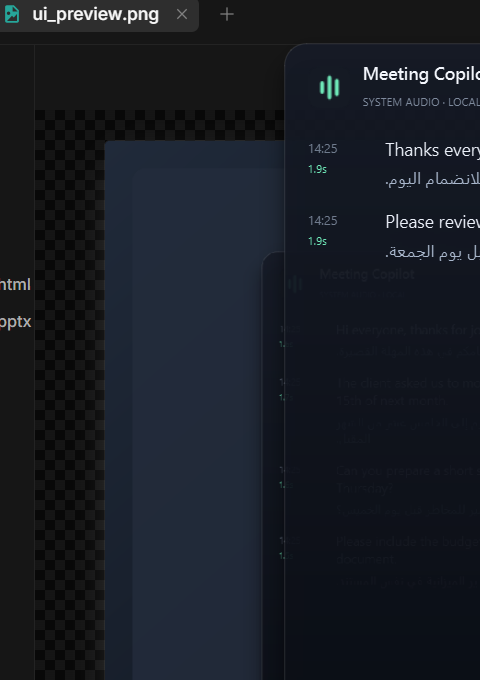

# Meeting Copilot

A privacy-first Windows desktop assistant for live English meetings. It listens to
**system audio** (the other participants), transcribes it locally, shows the
transcript in a floating window, and can translate every line to Arabic on the fly.
Polite reply suggestions and a one-line Egyptian-Arabic summary are next.




> **Status: Milestone 2** — floating desktop UI + local streaming transcription +
> optional Arabic translation. The LLM reply / Egyptian-Arabic summary is Milestone 3.

## نظرة سريعة (بالعربي)

- التطبيق بيسمع **صوت الاجتماع** الخارج من السماعات (WASAPI loopback) — **المايك مش مستخدم أبدًا**.
- التفريغ الإنجليزي بيحصل **محليًا** على جهازك بـ faster-whisper، من غير ما الصوت يطلع من الجهاز.
- نافذة صغيرة شفافة دايمًا فوق، بتتثبت جنب الاجتماع، وكل جملة إنجليزية بيظهر تحتها سطر عربي لما تشغّل زر **AR**.
- الترجمة اختيارية، وبتبعت **النص الإنجليزي فقط** لـ Google Translate بعد موافقة صريحة. الصوت عمره ما بيطلع.
- لسه مفيش ملف EXE جاهز (ده في الخطة M6)؛ التشغيل حاليًا من خلال Python و`.venv` و`run.cmd`.
- الترخيص Apache-2.0، وحقوق النشر محفوظة لـ **عمرو حافظ**.

## What you get

- A frameless, translucent **always-on-top** window that docks beside the meeting.
- Live English transcript, finalized sentence by sentence (about **1.7–1.9 s**
  after the speaker stops on the target laptop).
- Drag the header to move it, resize from the bottom-right corner, adjust opacity
  from the `⋯` menu; position/size are remembered.
- `Ctrl+H` hides it to the tray, `Ctrl+Shift+C` copies the latest sentence,
  `Ctrl+Q` quits. Closing the window stops capture.
- Optional **Arabic translation** under each English line, shown by tapping **AR**
  in the footer. It is off by default and asks for consent first, because it
  sends **text only** to Google Translate.
- Audio is captured from **WASAPI loopback only** — the microphone is never used.

The Arabic translation is Modern Standard Arabic. The one-line **Egyptian-Arabic
summary** and the suggested English reply are the next milestone (M3).

## Requirements

- **Windows 10 or 11** — capture uses WASAPI loopback, so macOS/Linux are not supported.
- **Python 3.10+** (tested with 3.13) and the packages in `requirements.txt`.
- Optional **NVIDIA GPU** with CUDA 12 + cuDNN 9 (`requirements-gpu.txt`) for the
  lowest latency. CPU works, but expect slower transcription.
- Internet on first run to download the Whisper model; after that transcription is
  fully offline. Arabic translation needs internet while it is enabled.

## Quick start

1. Set up once (below), then start the app with **`run.cmd`** (on your own
   machine you can also create Desktop/Start Menu shortcuts, below).
2. The window opens docked on the right side of the screen. Play any English
   meeting, video, or voice call.
3. Text appears when a sentence ends. Tap **AR** in the footer for Arabic
   translation (the first tap asks for consent). Use the `⋯` button or
   right-click for the other options.

The shortcut is only a launcher — the app stays in this folder. To recreate it
after moving the folder:

```powershell
powershell -ExecutionPolicy Bypass -File tools/install_shortcut.ps1
```

`run.cmd` launches without a console window. If nothing appears, run
**`run-console.cmd`** to see the error, and check **`logs\gui.log`**.

Terminal-only mode (the M1 interface) is still available via **`run-cli.cmd`**.

## Setup

```powershell
git clone https://github.com/amr-hafz/meeting-copilot.git
cd meeting-copilot
python -m venv .venv
.\.venv\Scripts\python.exe -m pip install -r requirements.txt

# Optional, for GPU inference:
.\.venv\Scripts\python.exe -m pip install -r requirements-gpu.txt

# Verify the model + device (first run downloads the model):
.\.venv\Scripts\python.exe -m app.cli --warmup
```

The first run downloads the Whisper weights from Hugging Face. After that the
transcription path is fully offline.

### If the Hugging Face download stalls

Python's downloader can sit at `read timeout` on slow connections. Use the
curl-based downloader instead; it resumes properly:

```powershell
# small, fast, good for a first test (~0.5 GB)
powershell -ExecutionPolicy Bypass -File tools/download_model.ps1 `
    -Name small.en -Repo Systran/faster-whisper-small.en

# best local accuracy, still fast on the Quadro T2000 (~1.5 GB)
powershell -ExecutionPolicy Bypass -File tools/download_model.ps1 `
    -Name distil-large-v3 -Repo Systran/faster-distil-whisper-large-v3
```

Models land in `.\models\<name>\` and are picked up automatically (the GPU
prefers `distil-large-v3`, then `distil-medium.en`, then `small.en`).

## Using the window

| Action | How |
|---|---|
| Move | Drag the header (the top bar with the title) |
| Resize | Bottom-right corner grip |
| Always on top | `⋯` → **Always on top** (on by default) |
| Dock to the right edge | `⋯` → **Dock to right edge** |
| Change transparency | `⋯` → **Opacity** |
| Copy latest sentence | `Copy` button, or `Ctrl+Shift+C` |
| Arabic translation | **AR** button in the footer, or `⋯` → **Arabic translation** |
| Clear transcript | `Clear` |
| Hide | the `–` button, `Ctrl+H` (while focused), or the tray menu |
| Show | Click the tray icon or use the tray menu |
| Quit | `×`, `Ctrl+Q`, or the tray menu |

Both menus expose **Always on top** and **Arabic translation**; the `⋯` menu
also has the layout and opacity controls. Hiding the window does **not** stop
capture; the tray tooltip says it is still listening. Closing the window stops
capture and quits.

### Terminal mode

```powershell
# Double-click run-cli.cmd, or:
.\run-cli.cmd

# See which output/loopback device will be captured
.\run-cli.cmd --list-devices

# Run a 60s test with a specific device
.\run-cli.cmd --audio-device "Headphones" --seconds 60

# Use a specific model / force CPU
.\run-cli.cmd --model small.en --compute-device cpu
```

Useful flags (both GUI and terminal):

| Flag | Default | Meaning |
|---|---|---|
| `--model` | auto | local `small.en` by default (better models auto-preferred if present) |
| `--compute-device` | auto | `cuda`, `cpu`, or `auto` |
| `--end-silence-ms` | 400 | silence that closes a sentence (lower = faster, more cuts) |
| `--max-utterance` | 12 | force-flush a sentence after N seconds |
| `--partials` | off | show grey live text while speaking (adds latency) |
| `--partial-interval` | 2.0 | seconds between live-text updates when enabled |
| `--save-transcript` | off | write text to `logs/` (audio is never saved) |

## What changed in Milestone 2

- **Desktop UI** in PySide6: translucent dark glass card, rounded corners,
  drop shadow, animated live waveform, tray icon, remembered geometry.
- **Capture fix:** read the loopback device at its native 48 kHz in ~100 ms
  blocks, then resample to 16 kHz. The tiny 20 ms reads were starving under GPU
  load and produced soundcard's `data discontinuity` warnings.
- **Latency fix:** first-inference CUDA warmup now happens at model load, and
  live partial transcripts are **off by default**. Partials competed with final
  sentences for the single ASR worker and added ~2 s in the live test. The final
  text now appears in ~1.7–1.9 s, including the 400 ms endpoint.
- **Optional Arabic translation** under each final line, opt-in and text-only.

## Pipeline

```
Teams/Zoom/Meet
      │  (system audio)
      ▼
WASAPI loopback ──► 48 kHz native ──► 16 kHz mono, 20 ms frames
      │
      ▼
Energy VAD ──► utterance buffer (300 ms pre-roll, 400 ms silence closes)
      │
      └── sentence closed ────────────► faster-whisper ──► final line
                                                │
                                                ▼
                                     (M3) LLM: reply + Arabic summary
```

**Threading:** capture thread → bounded queue → main thread (VAD) → single ASR
worker. Finalized utterances are queued, so no sentence is dropped when the GPU
is busy. Audio frames are dropped oldest-first if the pipeline ever falls behind,
instead of accumulating minutes of delay. Optional partial jobs (off by default)
are coalesced and never block a queued final sentence.

**Why sentences are not cut:** Whisper transcribes a whole VAD utterance, not an
arbitrary window, so punctuation and context survive. If someone talks without
pausing, the 12 s force-flush is the only place a sentence can be split.

## Benchmarks

Measured on the target laptop (Windows 10 Pro, i7-10850H, 16 GB RAM,
Quadro T2000 Max-Q 4 GB) with `small.en` on CUDA/float16, model stored in
`.\models\faster-whisper-small.en` (461 MB):

| Metric | Result |
| --- | --- |
| Model load (including warmup) | 2.7 s |
| Test clip | 29.1 s TTS meeting audio, 6 sentences |
| VAD segmentation | 6/6 sentences, no forced 12 s splits |
| ASR inference per sentence | 1.25–1.35 s (no slow first sentence now) |
| ASR RTF | 0.33–0.47x |
| End-to-end latency after sentence end | ~1.7–1.9 s (0.4 s endpoint + ASR) |
| Transcript accuracy | all 6 sentences transcribed correctly |

With `distil-large-v3` downloaded into `.\models\`, the app picks it automatically
and accuracy improves at a higher VRAM/RAM cost.

## Privacy and consent

- Opens **WASAPI loopback only**; the microphone is never accessed.
- Keeps audio **in RAM only**; there is no audio recording feature.
- Writes **no transcript** unless you pass `--save-transcript`.
- No telemetry, no analytics, no account, and no server operated by this project.
- Makes **one network request** on first run (Hugging Face model download).
  After that, transcription works offline.
- **Arabic translation is optional and off by default.** When you enable it, the
  app shows a consent dialog and sends the English text of each sentence to
  Google Translate (`translate.googleapis.com`). Audio never leaves the machine.
  You can turn it off again from the `⋯` / tray menu.

Things you should still handle:

1. **Tell the participants.** Recording/transcribing a meeting may require
   consent under company policy and local law. The visible `LIVE` badge helps.
2. **Company policy.** Some organisations forbid sending meeting content to
   external AI services. Local ASR is fine; Arabic translation and the future LLM
   stage are the parts to check.
3. **LLM data.** In Milestone 3 only text will be sent to the LLM. Prefer an API
   tier with no-training / zero-retention, send the minimum context, and add a
   redaction pass for names, emails, numbers and client identifiers.
4. **Do not treat suggestions as decisions.** The transcript and summary are
   aids, not a record. Verify anything important.
5. **Keys.** Store API keys in Windows Credential Manager, never in the repo.

## Troubleshooting

- **The window does not appear** — run `run-console.cmd` and read the error;
  also check `logs\gui.log`. Make sure the `.venv` exists and
  `requirements.txt` is installed.
- **The window is off-screen after changing monitors** — open the tray menu and
  choose `⋯` → **Dock to right edge**. As a last resort, remove the saved
  geometry: `Remove-Item HKCU:\Software\MeetingCopilot -Recurse`.
- **"No WASAPI loopback device found"** — enable an output device in Windows
  sound settings, then rerun `run-cli.cmd --list-devices`.
- **Bluetooth / device switch mid-call** — Windows invalidates the loopback
  stream. Restart the app; device hot-swap is on the M5 list.
- **CUDA model fails to load** — the NVIDIA pip wheels must match CUDA 12 and
  cuDNN 9. The app logs the reason and falls back to CPU. Reinstall
  `requirements-gpu.txt`, then run `--warmup`.
- **Too slow on CPU** — use `--model small.en` (or `tiny.en` for a quick test).
  GPU is strongly recommended for `distil-large-v3`.
- **Model download stalls at `read timeout`** — use
  `tools/download_model.ps1` (see Setup). Xet is disabled by default and local
  models under `.\models\` are preferred.
- **Arabic translation unavailable** — the free Google endpoint needs internet;
  the rest of the app keeps working offline. Check the connection and try again.

## Roadmap

| Milestone | Scope |
|---|---|
| **M1 (done)** | Loopback capture, VAD, final transcripts, latency stats |
| **M2 (done)** | Floating PySide6 window, tray, opacity, optional Arabic translation |
| M3 | LLM adapter (Gemini Flash-Lite default), polite English reply + Egyptian Arabic summary |
| M4 | Explain / rephrase / shorter actions, streaming output, copy buttons |
| M5 | Settings UI, device hot-swap, cost meter, error states, autostart, global hotkeys |
| M6 | PyInstaller EXE + installer, redaction, local-LLM option, retention controls |

## Layout

```
app/
  audio.py          WASAPI loopback capture + device discovery
  vad.py            energy VAD and utterance segmentation
  asr.py            faster-whisper wrapper with CUDA -> CPU fallback
  pipeline.py       threads, job scheduling, latency stats
  gui.py            PySide6 floating window, tray, options menu
  translate.py      optional Arabic translation (Google, text only)
  cli.py            terminal interface and flags
  config.py         runtime settings
  cuda_bootstrap.py makes NVIDIA pip-wheel DLLs visible on Windows
tools/
  test_vad.py       synthetic VAD checks (no audio needed)
  make_test_speech.ps1  generates a meeting-like TTS WAV
  selftest_file.py  WAV -> VAD -> ASR benchmark
  loopback_check.py plays the WAV and verifies real loopback capture
  ui_preview.py     renders the window with fake lines to `ui_preview.png`
  install_shortcut.ps1  creates the Desktop + Start Menu shortcuts
assets/
  meeting-copilot.ico   app / shortcut icon
docs/
  arabic-translation.png  screenshot used in this README
```

The `models/`, `.venv/`, `logs/` and `samples/*.wav` folders are intentionally
git-ignored: they are local caches, generated files, or private data.

## License

Copyright 2026 **Amr Hafez**.

Licensed under the **Apache License, Version 2.0** — see [LICENSE](LICENSE) and
[NOTICE](NOTICE). You may use, modify and distribute the project, including
commercially, provided you keep the copyright and license notices.

Meeting Copilot is provided **as is**, without warranty of any kind. It is a
meeting aid, not an official record; always tell participants that the meeting is
being transcribed and follow your company policy and local law.

